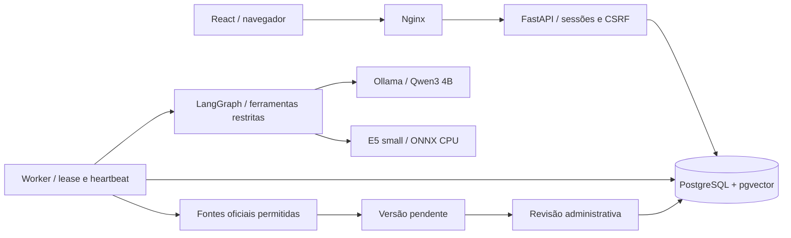

# JurisAssist

Assistente jurídico local para pesquisa trabalhista, terceirização e revisão de contratos fictícios, com RAG, ferramentas controladas e referências versionadas.

**English:** A local-first Brazilian legal research application demonstrating Python/FastAPI, LangGraph tool calling, hybrid RAG, evidence validation, model evaluation, PostgreSQL job processing, observability and AWS infrastructure as code. Inference runs locally through Ollama. AWS deployment is intentionally disabled; operational cloud scalability has not been demonstrated.

## O que está incluído

- Chat com histórico, perguntas de esclarecimento, fundamentos e feedback.
- Análise de contratos por lotes, incluindo obrigações, prazos, citações literais e revisão humana persistida.
- Biblioteca com versões imutáveis; novas leis exigem aprovação antes da indexação.
- Fila PostgreSQL com `SKIP LOCKED`, lease, heartbeat, limite de tentativas e publicação protegida por token.
- Autenticação por sessão, Argon2, CSRF, autorização por proprietário, limites compartilhados e trilha de auditoria.
- Modelos locais, avaliações reproduzíveis, testes de API e interface, métricas e infraestrutura Terraform.

O produto é um portfólio independente inspirado em necessidades de equipes empresariais. Os exemplos são fictícios e não representam documentos, orientações ou práticas da Ilhaservice. A aplicação apoia pesquisa e revisão humana; a validade das citações não comprova, por si só, a correção da interpretação jurídica.

## Começar no Windows

Pré-requisitos: Docker Desktop iniciado com WSL2, [Ollama](https://ollama.com/download/windows) e 15–20 GiB livres. A máquina usada na verificação tem 16 GiB de RAM e RTX 3060 Ti com 8 GiB. Nenhuma API paga é necessária. Os downloads iniciais precisam de internet; consultas a fontes já indexadas e inferência funcionam localmente.

```powershell
powershell -ExecutionPolicy Bypass -File scripts/setup.ps1
docker compose exec api jurisassist create-user
```

Se o Docker não estiver no PATH desta máquina, use `powershell -ExecutionPolicy Bypass -File scripts/create-user.ps1` para criar sua conta.

O script cria `.env` com senha aleatória do banco, baixa `qwen3:4b`, constrói as imagens e inicia os serviços. A criação de usuário pede e-mail, nome e senha de pelo menos 12 caracteres. O padrão é administrador; para contas de pesquisa use `--role user`. Não existe senha de acesso fixa no repositório. Snapshots públicos versionados deixam as fontes disponíveis para revisão mesmo quando o Planalto não responde ao container; a data de coleta é preservada.

Abra **http://localhost:8080**. Após entrar, vá a **Administração**:

1. Aguarde a coleta automática ou use **Verificar fonte**.
2. Abra **Revisar versão**, confira o texto e suas notas de alteração/vigência.
3. Confirme a revisão e aprove a indexação. Repita para as três fontes.
4. Aguarde a conclusão na tabela de tarefas. Teste o chat e um contrato fictício.

Se o comando `docker` não estiver no PATH, abra um novo terminal após instalar ou use a pasta `resources/bin` da instalação do Docker Desktop. O script procura também a instalação no perfil do usuário.

### Linux

```bash
bash scripts/setup.sh
docker compose exec api jurisassist create-user
```

No Linux, o Ollama precisa aceitar a conexão pela interface bridge utilizada pelos containers. Configure `OLLAMA_HOST` para o endereço dessa interface e bloqueie acesso externo por firewall. O `host-gateway` é cadastrado pelo Compose. **Não exponha a API do Ollama à internet.** No Docker Desktop, `host.docker.internal` normalmente encaminha ao serviço no Windows; confira o estado da IA na aplicação.

### Comandos de operação

```bash
docker compose ps
docker compose logs --tail 50 api worker
docker compose exec api jurisassist download-embeddings
docker compose exec api jurisassist evaluate --matrix
docker compose exec api jurisassist evaluate --mode hybrid --prompt v2 --generate
docker compose stop
docker compose start
```

O primeiro uso de embeddings baixa uma conversão ONNX quantizada do multilingual-e5-small. `download-embeddings` antecipa esse download. Os comandos de avaliação exigem as três fontes aprovadas. `--matrix` compara três recuperadores e dois prompts; **sem `--generate`, mede somente recuperação**. Com `--generate`, executa o LLM real e preserva resultados para revisão humana. Isso pode levar bastante tempo na máquina local.

`docker compose down` remove containers, preservando volumes. A opção `-v` apaga banco e dados: não faz parte do fluxo de operação deste projeto.

## Desenvolver sem reconstruir imagens

Requisitos adicionais: Python 3.12 e Node.js 22 LTS.

```powershell
python -m venv .venv
.\.venv\Scripts\python -m pip install uv
.\.venv\Scripts\uv sync --frozen --extra dev --extra embeddings
docker compose up -d db
.\.venv\Scripts\alembic upgrade head
.\.venv\Scripts\jurisassist init-sources
.\.venv\Scripts\jurisassist create-user
.\.venv\Scripts\uvicorn jurisassist.api:app --host 127.0.0.1 --port 8000 --no-access-log
```

Em outro terminal, execute `.\.venv\Scripts\python -m jurisassist.worker`. Para a interface:

```powershell
cd frontend
npm ci
npm run dev
```

Abra http://localhost:5173. A interface encaminha `/api` à API local. No Linux, use `source .venv/bin/activate` e os mesmos comandos sem o prefixo Windows. O banco da aplicação é PostgreSQL; SQLite é usado apenas em testes rápidos.

Configurações ficam em `.env.example`. `.env`, modelos, credenciais, snapshots e relatórios operacionais são ignorados pelo Git. No ambiente Docker, relatórios ficam no volume `app-data`; no desenvolvimento nativo, em `data/evaluations`.

## Arquitetura



O monólito modular tem processos separados de API e worker. Isso mantém a implantação local simples e permite escalar esses processos independentemente no futuro. Um worker é o padrão para proteger a GPU. O histórico durável fica no banco; em falhas, uma tarefa recomeça de forma limitada, sem publicar resposta parcial. Não há retomada nó a nó do LangGraph nesta versão.

## API e testes

Contrato interativo: http://localhost:8000/docs. Rotas em `/api/v1`: autenticação, conversas, mensagens, documentos, exemplos, análises, revisões, feedback, tarefas e administração. `POST` de mensagens e análises aceita `Idempotency-Key`. Mutações autenticadas exigem `X-CSRF-Token`, recebido no login. SSE publica eventos `status`, `final` e `error`; não transmite texto ainda não validado.

```powershell
.\.venv\Scripts\pytest -q
.\.venv\Scripts\ruff check backend tests migrations
cd frontend
npm run build
npx playwright install chromium
npm run test:e2e
```

Testes rápidos usam doubles explícitos do modelo e dos embeddings. O teste PostgreSQL exige `TEST_DATABASE_URL` apontando para **banco descartável**: ele aplica e reverte as migrações nesse banco. A CI fornece esse banco em container. Testes de interface usam contratos de API simulados; testes de API/worker exercitam as operações reais com modelo controlado. Resultados de inferência real são documentados separadamente.

Para carga: `locust -f tests/load/locustfile.py --host http://localhost:8000`, com `LOAD_EMAIL` e `LOAD_PASSWORD` definidos no ambiente. Comece com um usuário; limites de taxa e uma consulta ativa por usuário são intencionais. Não reutilize contas reais em testes.

## Documentação

- [Decisões e limites arquiteturais](docs/architecture.md)
- [Operação, backup, restauração e diagnóstico](docs/operations.md)
- [Avaliação, rubrica e experimentos](docs/evaluation.md)
- [Infraestrutura AWS preparada, sem implantação](infra/aws/README.md)
- [Apresentação do portfólio e roteiro de vídeo](docs/portfolio.md)
- [Resultados de verificação desta entrega](docs/verification.md)

## Fontes e licenças

Fontes oficiais iniciais: [CLT compilada](https://www.planalto.gov.br/ccivil_03/decreto-lei/del5452compilado.htm), [Lei nº 6.019/1974](https://www.planalto.gov.br/ccivil_03/leis/l6019.htm) e [Código Civil](https://www.planalto.gov.br/ccivil_03/leis/2002/l10406compilada.htm), com artigos 421 a 609 indexados neste último. O parser remove textos tachados e dispositivos explicitamente revogados; notas de alteração e vigência exigem revisão. Não existe garantia automática de vigência ou cobertura jurídica completa.

Modelo [Qwen3 4B](https://ollama.com/library/qwen3:4b), Apache 2.0; embeddings [multilingual-e5-small](https://huggingface.co/intfloat/multilingual-e5-small), MIT, conversão [Xenova ONNX](https://huggingface.co/Xenova/multilingual-e5-small). As licenças de dependências e modelos permanecem aplicáveis. Código próprio sob [MIT](LICENSE).
